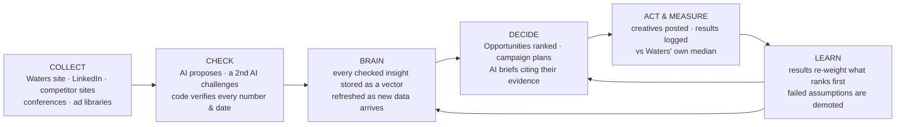

# Platina AI OS × Waters — presentation content

> **How to use this file.** Paste everything below into claude.com and ask:
> *"Build a 6-slide presentation from this content. Follow the design direction, the slide order and the
> speaker notes. Use only the facts in the Fact sheet. Do not invent numbers."*
>
> Deck: 6 slides. Slide 1 is the intro. Slides 2–4 are content. Slide 5 is the live demo. Slide 6 is the close.
> Length: 20–25 minutes, including about 8 minutes of live demo.
> Audience: Waters GCC sales and marketing leadership.

---

## 0. Design direction (for the deck generator)

- **Palette:** light background. Brand blue `#0176D3` for buttons and highlights, sky blue `#00A1E0` for
  accents and data lines, deep navy `#032D60` for headings, soft grey `#F3F6F9` for panels. Use one accent
  colour per slide.
- **Type:** a clean sans-serif. Large headlines with at most 8 words each. Body text in short lines, never
  paragraphs.
- **Visual language:** flows, loops and connected nodes (a "living system"), never stock photos of robots.
  Use one diagram per content slide.
- **Colour code used on every slide:**
  - **Blue** = Waters' own data (first-party, Plane A)
  - **Amber** = public market data (competitors, events, ad libraries; Plane B)
  - **Violet** = the AI Brain (checked insights, Plane C)
  - **Green** = human decisions
- **Tone:** confident and precise. Every claim either has a number with a source, or is labelled "next".

---

## 1. The story arc (the psychology behind the order)

| Slide | What the audience should feel | Job of the slide |
|---|---|---|
| 1. Intro | Curiosity: "this is about us" | Open with Waters' world, not our product |
| 2. The gap | Recognition, then tension | Name the pain they live with: market signals are scattered, competitors move first, decisions rely on guesswork |
| 3. The self-teaching system | Relief and wonder | Reveal the architecture: AI that collects, checks, plans, measures and teaches itself |
| 4. Humans in control | Trust | Show the guardrails: people approve, code checks every number, nothing is invented |
| 5. Live | Proof, then belief | Show it running on Waters' real data, right now |
| 6. The close | Commitment | A concrete next step tied to a date they care about (ARABLAB LIVE, 26 Oct) |

The rule behind the flow: **open with their world → create tension → reveal → earn trust → prove it live → ask
for one small, specific yes.**

---

## SLIDE 1 — Intro

**Headline:** Your market is talking. Now your brand can listen, learn and act in real time.

**Sub-headline:** Platina AI OS: AI orchestrated by AI, controlled by humans. Built for Waters' growth in the GCC.

**On screen:**
- Platina AI OS logo, Waters logo, date
- One line: *"Built on Waters' own data, not a generic demo."*
- A small live badge: **"Live: 290 market items collected · 174 AI insights · 6 companies watched"**

**Visual:** a dark-to-light gradient with a faint network of connected points: the Brain, drawn softly behind the
title.

**Speaker notes (about 1 min):**
> "Everything you will see today runs on Waters' real data. Your website, your LinkedIn, your competitors and the
> events in your region. None of it is a mock-up. We'll start with the problem, show you how the system thinks,
> show you who stays in control, and then we'll open it live."

---

## SLIDE 2 — The gap (content 1 of 3)

**Headline:** The signals that win deals are scattered and fast. They go stale in weeks.

**Three pain points (one column each):**

1. **Scattered signals**
   Competitor launches, LinkedIn conversations, conference exhibitor lists, ad libraries and your own 580+ web
   pages all sit in different places. No one has time to read them all every week.
2. **Competitors move first**
   Thermo Fisher, Agilent, Shimadzu, SCIEX and Bruker publish, advertise and exhibit continuously. *Example:*
   Bruker's own posts showed it going to ARABLAB LIVE 2026 before the event's exhibitor list named it.
3. **Plans rest on gut feeling**
   Campaign choices rarely trace back to evidence, and results rarely flow back to shape the next choice. The
   same guesses are repeated.

**The cost line (bottom band):** *Every week without a system, the market's knowledge goes to whoever reads it
first.*

**Visual:** on the left, a messy scatter of amber icons (web, LinkedIn, ads, events). On the right, a single empty
"decision" box with a question mark. There is nothing connecting them yet.

**Speaker notes (about 2 min):**
> "Your sales team already knows this feeling. The information exists, it's public, it's on your own site, but
> it's in 50 places and it changes every week. The question isn't 'do we have data?' It's 'who connects it into
> a decision first?'"

---

## SLIDE 3 — A system that teaches itself (content 2 of 3)

**Headline:** It collects, thinks, plans, measures, and then learns from what happened.

**The loop (the core diagram of the deck):**

**Five short statements beside the diagram:**

1. **Collect, automatically and on schedule.** Scrapers run on a cadence: Waters' own site (first-party),
   competitor sites, LinkedIn company posts, conference pages and public ad libraries.
2. **AI checks AI.** A proposer model makes a claim; a challenger model on a *different* provider disputes it.
   Only the surviving, cited claim enters the Brain.
3. **A model never makes up a number.** Engagement, momentum, dates and days-to-event are computed by code. When a
   model reads a date, code checks that the words are really on the page.
4. **The Brain feeds every decision.** Ideation, the campaign planner and the Opportunities guide all retrieve
   from the same checked insight store (vector + keyword search, ranked by relevance).
5. **It learns from outcomes.** Each result is scored against Waters' own median. A learning engine (Thompson
   sampling with a 90-day memory) re-weights topics, formats and channels. About 20% of suggestions deliberately
   "try something new" and are labelled so. When a result fails, the evidence the plan rested on is demoted.

**The "AI orchestrated by AI" band (bottom):**
> One routing layer chooses between four AI providers (Groq, Gemini, NVIDIA, AWS Bedrock) based on speed,
> quality and live rate limits. If one slows down, the next takes over. Swapping a provider is a configuration
> change, not a rebuild.

**Visual:** the loop as a glowing circle. Each stage is coloured in the plane colour code: collect = amber and
blue, Brain = violet, decide/learn = green-edged. Small particles travel around the loop.

**Speaker notes (about 3 min):**
> "This is the heart of it. Most AI tools answer a question and forget. This one keeps a memory of every checked
> insight, uses it to plan, and then watches what actually happened. If a campaign on PFAS testing beats your
> normal engagement, PFAS rises. If an assumption fails, the system traces back to the evidence it rested on
> and lowers its trust. It's not a black box: every weight can be read and every change has a cause."

**Honesty note (say it if asked, or show it small on the slide):** the collection, Brain, planner, opportunities
and the learning loop (results → re-ranking) are built and running. The suggestion ledger with full credit
assignment and the monthly "what we learnt" digest are the next build step (Nov 2026).

---

## SLIDE 4 — AI power, human control (content 3 of 3)

**Headline:** The AI does the heavy lifting. People make the calls.

**Left: "What the AI does"**
- Reads hundreds of pages and posts every week
- Measures interest momentum per topic across 6 companies
- Finds events in the region, with proof of who is attending
- Ranks opportunities and drafts campaign briefs step by step
- Learns which topics, formats and hooks work for Waters

**Right: "What people control"**
- **Brand standard:** only lines a person confirms become Waters' "brand DNA"
- **Lessons:** a result review becomes a lesson only after a person confirms it. The AI never teaches itself
  from its own unreviewed guesses.
- **Budgets:** every paid run checks its budget first. Nothing runs over budget without approval.
- **Dismiss with a reason:** "wrong fact" lowers the trust of the insight named
- **Final decisions:** plans and creatives are always approved by the team

**Middle: the trust contract (four rules, each shown as an icon)**

| Rule | What it means for Waters |
|---|---|
| **Two separate layers** | Waters' own data and public competitor data are never mixed. A competitor's claim can never be cited as Waters' proof. |
| **Nothing synthesised** | A number no platform reported shows as "not measured", never an estimate dressed up as fact. |
| **Minimum evidence** | Below 5 data points, no score is shown, only "not enough data yet". |
| **Every number has a proof link** | Click any figure and see the post, page or event it came from. |

**Data-flow strip (bottom):**
`Waters' own site (blue)` + `public market (amber)` → `checked insights (violet Brain)` → `human-approved
decisions (green)` → `measured results` → back into the Brain.

**Visual:** a split screen. The AI side is a violet network; the human side is green checkpoints (a person
icon at each gate). A thin line between them is labelled "approval gates".

**Speaker notes (about 2 min):**
> "This is where most AI projects lose trust. We designed it the other way round. The system never invents a
> number. It never blends your data with a competitor's. And the things that shape your brand (the standard,
> the lessons, the budget) all wait for a human yes. That's the balance: maximum AI range, human judgement at
> every gate."

---

## SLIDE 5 — Live: Waters, right now

**Headline:** Live on Waters' data.

**On screen (before switching to the browser):** the path you will walk, as 5 numbered chips:
`1 Live flow → 2 Brain map → 3 Events: ARABLAB → 4 Opportunities + AI brief → 5 Competitors: read a URL now`

**Demo script (about 8 min). Workspace `waters-gcc-internal`, URLs under `/p/waters-gcc-internal/…`**

| # | Page | Do | Say | Proof moment |
|---|---|---|---|---|
| 1 | **Live flow** `/live` | Open it and let the 3D flow run | "Sources on the left, AI analysis, the Brain, decisions, results. Node size is the real count; particles are the last 24 hours." | The counts match the badge on slide 1 |
| 2 | **Brain map** `/brain-map` | Rotate, hover an insight, click one | "Every company, topic, event and insight as one graph. Each link is explained in a sentence." | The full insight text with its source |
| 3 | **Events** `/events` | Open ARABLAB LIVE 2026 | "26–28 Oct, Dubai. The exhibitor list names Bruker, Shimadzu and Thermo Fisher, and Bruker's own posts confirmed it earlier." | Proof links to the posts and the page |
| 4 | **Opportunities** `/opportunities` | Open the top pick, then generate the AI campaign brief | "Why now, who else is there, start-by date, rank factors. The brief streams step by step and cites public evidence and Waters' own pages separately." | Citations labelled by source layer |
| 5 | **Competitors** `/competitors` | Paste a competitor product-page URL | "Watch it classify, read and turn the page into findings live." | The step-by-step panel updates without a reload |

**Close the demo with:** *"Everything you just saw was collected, checked and ranked by the system. Our role
was to decide what matters."*

**Backup:** keep screenshots of each page in the deck's appendix in case the network fails.

**Pre-demo checklist (the morning of the presentation):**
- Run `npm run platina:readiness -- --ws waters-gcc-internal` and update the numbers on slides 1 and 6
- Sign in with the workspace owner's account (the test account can't see Waters' data)
- Generate one AI brief in advance: with today's free-tier AI quotas, a brief can take up to about 2 minutes,
  so keep one ready and generate a second one live
- Open all 5 tabs in advance; 3D pages pause in hidden tabs and resume when shown

---

## SLIDE 6 — The close

**Headline:** From signals to sales conversations, before your competitors get there.

**What Waters gets:**
- **Always-on market radar:** competitors, events and interest topics across the GCC, refreshed automatically
- **A campaign guide:** what to run, where, when and why, with a start-by date and its evidence
- **A system that gets smarter with every campaign:** results feed back, and weak assumptions fade
- **Full control and traceability:** people approve; every number has a source

**The next 30 days (timeline graphic):**

| When | Milestone |
|---|---|
| This week | Waters confirms its brand standard lines (a one-time review) |
| 1 Oct | Public ad-library insight (LinkedIn and Meta) for Waters and its 5 competitors |
| 23 Oct | Live mode switched on for ARABLAB LIVE |
| 26–28 Oct | ARABLAB LIVE watched in real time: competitor activity, posts and interest as they happen |
| November | The learning engine traces every suggestion, plus the first monthly "What we learnt" digest |

**The ask (one sentence, large):**
> Let's run ARABLAB LIVE together: you log your campaign results, and the system shows you what worked, why,
> and what to do next.

**Visual:** the loop from slide 3, now closed and glowing, with a single green "Start" node on 26 Oct.

**Speaker notes (about 2 min):**
> "We don't need a big commitment to prove this. ARABLAB is 32 days away. Give us your results as they happen,
> and in November you'll see the first month of a system that has learned from Waters' own outcomes. That's
> the point where AI stops being a tool and starts being a teammate."

---

## Fact sheet (the only numbers the deck may use)

**Live counts, workspace `waters-gcc-internal`, readiness report of 24 Sep 2026, 07:06 UTC**
(refresh these on the morning of the presentation):

| Measure | Value |
|---|---|
| Market items collected (Plane B) | 290 |
| AI insights in the Brain | 174 |
| Findings | 325 |
| Collection runs | 157 |
| Interest signals | 383 |
| Upcoming events with a date | 35 (plus 23 without a date yet) |
| Clients and competitors tracked | 6 (Waters + Thermo Fisher, Agilent, Shimadzu, SCIEX, Bruker) |
| Waters own-site passages read (first-party) | 2,137 |
| Waters own-site pages known | 580+ (300 selected for reading) |

**From the live build log (21–23 Sep 2026):**
- 3-month LinkedIn backfill: 151 posts from 6 companies, for about $0.30
- Interest example (21 Sep): **PFAS analysis** at 1.34× normal engagement (8 posts, 3 companies);
  **mass spectrometry** at 1.09× (41 posts, 6 companies)
- ARABLAB LIVE 2026: 26–28 Oct, Dubai. The exhibitor list names Bruker, Shimadzu and Thermo Fisher. Bruker's
  attendance was first found through three of its own LinkedIn posts.
- A planner brief about "a Dubai trade show" retrieved the ARABLAB insight first. A plan was created from an
  opportunity in about 10 seconds, citing its evidence.
- Waters context: BD Biosciences has been part of Waters since the combination of 9 Feb 2026, so its pages count
  as Waters' own.

**How it works (for Q&A):**
- AI providers: Groq, Google Gemini, NVIDIA and AWS Bedrock behind one router, with fast and quality ladders, and
  a different order for interactive and background work
- Debate: a proposer and a challenger run on different models; only cited claims survive
- Learning: a Beta posterior per feature (topic, channel, format, hook, timing), 90-day half-life, a minimum of 5
  results before anything moves a ranking, and a 20% explore share
- Data rules: first-party and public data are kept in separate layers; no metric is synthesised; every number
  has a proof link; each workspace's data is isolated
- No ad-account logins: ad insight comes from public ad libraries only (activity, not performance)
- Real-time: pages update on live signals; the 3D Live flow shows arrivals as they happen

**What NOT to claim:**
- No sales, revenue, lead or ROI figures. None has been measured yet. Say "sales impact will be measured from
  the results Waters logs."
- No ad spend, CTR or conversions for competitors. No ad library publishes them.
- Don't say "deep reinforcement learning". Say "a feedback loop plus a learning engine (Thompson sampling) over
  Waters' own results".
- The suggestion ledger, credit assignment and monthly digest are **next** (Nov 2026), not live.

---

## Likely questions and short answers

- **"Is our data used to train public AI models?"** Waters' data is isolated in its own workspace, and each AI
  call sends only the text that task needs. Whether a provider may use those inputs depends on its plan: paid
  API tiers don't train on them, while some free tiers can. Moving to paid keys is planned before production.
  *(Check each provider's current terms before answering this in the room.)*
- **"How do we know the AI isn't making things up?"** Code computes every number. Dates must appear on the source
  page. A second model challenges each claim, and every figure links to its source.
- **"What if an AI provider goes down?"** The router moves to the next provider automatically.
- **"What does the team have to do?"** Confirm the brand standard once, approve plans, and log results. The
  system does the collecting, reading and ranking.
- **"When will we see it learn?"** As soon as there are 5 or more logged results for a feature. ARABLAB LIVE is
  the first natural test.
