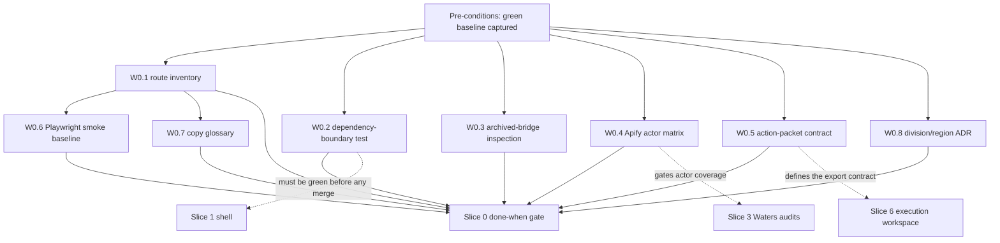

# Platina AI OS for Waters — Slice 0 Task Plan: Baseline, Safety, and Product Contract

**Date:** 2026-09-16
**Status:** Proposed — authorizes Slice 0 execution only
**Governing plan:** [2026-09-11-platina-waters-realtime-full-suite.md](./2026-09-11-platina-waters-realtime-full-suite.md), including the Revision addendum 2026-09-15 (R1–R5)
**Product surface:** `/p/[ws]` only

This is the implementation-ready task plan for Slice 0 ("Baseline, safety, and
product contract") of the governing plan. A developer or agent executes it top
to bottom; no design decision is left open. Approval of this document
authorizes Slice 0 only. Each later slice receives its own task plan.

Slice workflow rule (from the governing plan, binding on every workstream
below): **spec confirmation → failing tests → minimal implementation → CI
gates → browser verification → review → owner approval.**

## Document precedence

When documents conflict, use them in this order (restated from the governing
plan so Slice 0 executors never have to look it up):

1. `CLAUDE.md` — build constitution and non-negotiable architecture.
2. The approved governing plan + 2026-09-15 addendum.
3. `platina-waters-dataflow-revised.html` — Waters product/dataflow reference.
4. Platina code and tests.
5. InstaMedia architecture, audits, catalogues, and historical plans —
   implementation precedent only, never Platina product requirements.

## Resolved decisions baked into this plan

Already owner-approved. Do not re-open.

- `workspace_id` is the only security boundary. Division and region are
  metadata on a `platina_workspace_profiles` table (lands Slice 2). One
  workspace = one division × region. Cross-division rollups are Deferred
  (see W0.1 and W0.8). No second tenant key, no concatenated division-region
  id, no Postgres RLS — isolation is enforced at the app layer because the app
  connects through `DATABASE_URL` (a plain Postgres role; `auth.uid()` is
  always NULL).
- V1 fetch: Apify for content. Header-only change probes (conditional
  GET/`ETag`/`If-Modified-Since`, sitemap `lastmod`, RSS/Atom — no content
  retrieval) are permitted as own code per R1. Probe-less source kinds use
  adaptive cadence starting at 6 hours. Default probe cadence is 5 minutes.
- Synthetic/demo outcome data is labelled AND structurally excluded from
  evidence write-back, min-N baselines, and retrieval.
- The two latent bridges are archived: `platina_campaigns.sop_run_id` and
  Platina alert actions `hub_message` / `ticket` / `email` are never read,
  never written, never executed. W0.3 inspects existing rows; the drop
  migration is a later, separately approved step.
- The 2026-09-15 baseline is green: typecheck, lint, 1544 tests, and the
  production build all pass at commit `dcff5cd`.

---

## Pre-conditions

The 2026-09-15 compile fix is part of this baseline. Do not treat red gates as
acceptable pre-existing debt.

- [ ] Confirm HEAD is `dcff5cd` (or a later commit whose gates are green).
- [ ] Re-run the full gate suite and capture the complete output as the Slice
  0 entry artifact:

  ```bash
  npm run typecheck && npm run lint && npm test && npm run build
  ```

- [ ] Save the captured output to
  `docs/superpowers/plans/2026-09-16-slice-0-baseline-output.txt` and commit it
  with the W0.1 inventory.
- [ ] If any gate is red: stop, record the failure separately, and report to
  the owner before writing any code. Do not build Slice 0 on a red baseline.
- [ ] Record the expected test count (1544 at `dcff5cd`) in the baseline
  output header so later slices can detect silent test loss.

---

## W0.1 — Route and use-case inventory

**Purpose.** One owner-reviewable document that maps every current `/p/[ws]`
surface to its target destination in the new information architecture, with an
honest status. Everything else in Slice 0 cites this inventory.

**Files:**

- Create: `docs/superpowers/plans/platina-route-inventory.md`

**Content requirements.**

1. One row per route/surface below, generated from the actual code (the draft
   table below is pre-filled from a 2026-09-16 code reading; the executor
   re-verifies each row against the file cited before committing). Status
   vocabulary: **Live** (behaves as the target product requires),
   **Partial** (exists but does not meet the target contract), **Gap** (target
   requires it, nothing exists), **Deferred** (explicitly postponed with a
   recorded reason), **Refused** (must never ship in Platina).
2. A second table covering the eight Platina Inngest functions registered in
   `src/app/api/inngest/route.ts`, noting which move workflow state and which
   only count rows.
3. An "Outbound network surface" section enumerating every network call
   reachable from `/p` code, confirming none writes to any Waters production,
   test, QA, CRM, marketing-automation, DAM, CMS, email, ad, or event system.
   Verified 2026-09-16: the only outbound calls are the Apify
   `run-sync-get-dataset-items` endpoint (reached transitively via
   `@/lib/connectors/apify` from `src/lib/platina/fetch/apify.ts`), model
   router providers (Groq / Gemini / Bedrock via `src/lib/ai/router.ts`),
   Inngest event sends (`src/inngest/client.ts`), and the Supabase Postgres
   connection. No Waters system endpoint or credential exists.
4. A note recording that `listApprovedScanSpecs()` and
   `listActiveAlertRules()` in `src/db/queries/platina.ts` are deliberately
   global enumerations for cron fan-out (per-record workspace scoping happens
   downstream). Recorded, not changed — Slice 0 changes no behavior.

**Draft inventory table (pre-filled; verify before committing):**

| Route / surface | Verified current behavior | Target (transition table) | Status |
|---|---|---|---|
| `/p/[ws]` (`src/app/(platina)/p/[ws]/page.tsx`) | Five count tiles (scan specs, brain insights, receipts, campaigns, gate events); copy reads "InstaMedia stays at `/w/{ws}`"; eyebrow "S2 · cockpit"; cannot start, monitor, or inspect work | Cockpit (rebuilt Slice 1, completed Slice 11) | Partial |
| `/p/[ws]/brand` (`brand/page.tsx`) | Declare-standard textarea (gate `declare` via `declareBrandAction`); lists Plane A chunks; "N Gate 1 events written"; eyebrow "S1 · gate 1" | `/admin/brand` | Partial |
| `/p/[ws]/scans` (`scans/page.tsx`) | Creates draft spec with one target, `kind` hardcoded `competitor_site`; "Gate 2 · confirm fetch" approves and sends `platina/scan.requested`; no run status or `lastRunAt` lifecycle; eyebrow "S3–S5 · gate 2" | `/audits` | Partial |
| `/p/[ws]/brain` (`brain/page.tsx`) | Lists active Brain chunks exposing `gen`, `agreementState`, `confidence`, `status`; eyebrow "S6–S7 · plane C" | `/findings` (+ hidden technical provenance) | Partial |
| `/p/[ws]/ideation` (`ideation/page.tsx`) | Two-bucket list; `minNGate(chunks, 1)` hardcodes min-N of 1; `draftProposals` is deterministic — no model call, no semantic retrieval (`retrieveBuckets` unused); Gate 3 approval writes receipt + campaign with hardcoded `proposeCampaignDetail` values; eyebrow "S8–S10 · gate 3" | `/solutions/new` | Partial |
| `/p/[ws]/campaigns` (`campaigns/page.tsx`) | Campaign list; "Gate 4 · approve to ship" writes a gate event only — no campaign state change, no executable work; eyebrow "S10–S11 · gate 4" | `/solutions` | Partial |
| `/p/[ws]/claims` (`claims/page.tsx`) | Deterministic screen via `enforceClaims` with hardcoded banned/regulated lists; disconnected from the Brand Gene and final approval | Solution Claims tab + `/admin/claims` | Partial |
| `/p/[ws]/receipts` (`receipts/page.tsx`) | Receipt list; grading writes `worked` / `did_not_work` / `inconclusive`; no write-back to first-party evidence, no demotion of contradicted hypotheses; eyebrow "S9 · S12" | `/outcomes` + solution Decision history | Partial |
| `/p/[ws]/config` (`config/page.tsx`) | Threshold form (`minBaselineN`, `contestedFloor`, `qualifiedFloor`) gated by `gate.approve`; saved values are not consumed by the runtime paths they govern (contradiction uses `CONTESTED_FLOOR`/`QUALIFIED_FLOOR` constants in `src/lib/platina/contradiction.ts`; ideation hardcodes 1); eyebrow "SOP harness" | `/admin` | Partial |
| Sidebar "Open InstaMedia" link (`src/components/platina/sidebar.tsx`) | Links to `/w/[ws]/overview` from every Platina page | Removed in Slice 1 | Refused |
| `/p/[ws]/audits`, `/findings`, `/solutions`, `/outcomes`, `/admin/*` | Do not exist | Registered by Slice 1 shell | Gap |
| Realtime / live invalidation | No Platina Realtime subscriber, status grammar, or polling fallback exists | Slice 2 event spine | Gap |
| Audit run lifecycle (`platina_audit_runs`, run events) | No run table; scan status/`lastRunAt` not maintained through the job lifecycle | Slice 2 schema + orchestrator | Gap |
| Cross-division executive rollup | Not present; one workspace = one division × region | Deferred per R3 — a future read-only cross-workspace executive view requires its own owner-approved contract covering authorization, aggregation rules, and minimum sample suppression | Deferred |
| `platina_campaigns.sop_run_id` bridge (`src/db/platina-schema.ts` line 352) | Column exists; no application code reads or writes it (verified 2026-09-16) | Archived — never read/written/executed; W0.3 inspects rows; drop migration follows separately | Refused |
| Alert actions `hub_message` / `ticket` / `email` (`src/db/platina-schema.ts` line 108) | Type allows the three archived kinds; `alert-sweep` evaluates but never delivers; `src/lib/platina/alerts.test.ts` fixtures still use the archived kinds | Archived — V1 routes `in_app` only; enum migration is a later slice | Refused |

**Draft background-function table:**

| Function (`src/inngest/functions/platina/`) | Trigger | Current behavior | Moves workflow? |
|---|---|---|---|
| `signal-scan.ts` | cron `0 */6 * * *` + `platina/scan.requested` | Fetches approved specs through the registered `apify` adapter (which invokes an Instagram-post connector — see W0.2 exception) and inserts signal documents; no run status, no dedupe hash | Partially |
| `contradict-sweep.ts` | cron `30 */6 * * *` + `platina/contradict.requested` | Re-reads up to 5 unresolved signals per workspace, runs one contradiction round, writes transcript + Brain chunk; contested/refuted are counted, not routed | Partially |
| `brain-maintenance.ts` | cron `0 4 * * 1` | Compacts stale gen-0 groups into gen-1 records | Yes |
| `receipt-review.ts` | cron `0 9 * * *` | Counts due receipts per workspace | No |
| `outcome-ingest.ts` | cron `0 2 * * *` | Counts outcome rows per workspace | No |
| `alert-sweep.ts` | cron `0 * * * *` | Evaluates rules against latest outcome with hardcoded `minN: 5`; counts matches; delivers nothing | No |
| `event-window.ts` | cron `0 6 * * *` | Counts campaigns inside the event window | No |
| `divergence-scan.ts` | cron `0 5 * * 1` | Counts brand chunks per workspace | No |

**Test specification.** None — this workstream produces a document. The
document's accuracy is enforced by review: every row cites a file path the
reviewer can open.

**Acceptance criteria.**

- Every route, shell element, background function, Gap, Deferred, and Refused
  row above appears in the committed inventory, verified against the cited
  file.
- The cross-division rollup row carries the R3 reason verbatim in substance.
- The two archived bridges appear as Refused with the archive rule restated.
- The outbound-network section confirms no Waters-system write path.
- Owner has reviewed the inventory (review sign-off is part of the done-when
  gate).

---

## W0.2 — Dependency-boundary test

**Purpose.** A static, deterministic test that fails CI if any Platina code
imports an InstaMedia business module. This is the automated enforcement of
the constitution's parallel-product rule, and it must be green before any
later slice merges.

**Files:**

- Create: `src/lib/platina/boundary.test.ts`

**Design (fully specified — implement as written).**

Walk these roots with `node:fs` (precedent: `src/theme-migration.test.ts`,
including its Windows-separator normalization via `relSrc`), collecting
`.ts`/`.tsx` files and skipping `.test.` files except where noted:

- `src/app/(platina)/`
- `src/components/platina/`
- `src/lib/platina/`
- `src/inngest/functions/platina/`
- `src/db/platina-schema.ts`
- `src/db/queries/platina.ts`

Extract import specifiers with a regex over `import … from "…"`,
`export … from "…"`, and `import("…")`. Classify each specifier:

**Allowlist (exact specifiers or prefixes):**

- Any non-`@/` package import (`next/*`, `react`, `drizzle-orm`, `inngest`,
  `node:*`, `zod`, etc.) — packages cannot cross the internal boundary.
- Relative imports (`./`, `../`).
- `@/auth` — shared authentication (`requireUser`, `auth`).
- `@/db` — the database client (`src/db/index.ts`).
- `@/db/schema` — identity tables only (`users`, `orgs`, `workspaces`,
  `memberships`).
- `@/db/platina-schema`, `@/db/queries/platina` — own schema and queries.
- `@/db/queries/memberships` — `requireMembership` / `requireCapability`.
- `@/db/queries/workspaces` — identity enumeration (`listAllWorkspaceIds`)
  used by cron fan-out.
- `@/lib/permissions` — the capability matrix.
- `@/lib/ai/router` — the model router (the only `@/lib/ai/*` module Platina
  may import).
- `@/lib/utils` — `cn` (used by `src/components/platina/sidebar.tsx`).
- `@/lib/platina` (prefix), `@/components/platina` (prefix).
- `@/inngest/client` — the shared Inngest client.

**Forbidden globs (fail even if someone later adds them to the allowlist).**
Enumerated from `src/db/queries/` and `src/lib/` on 2026-09-16, grouped by the
constitution's seven module families:

- Ticket: `@/db/queries/tickets`, `@/db/queries/ticket-comments`,
  `@/db/queries/ticket-activity`, `@/lib/tickets`, `@/lib/ticket-permissions`
- Hub: `@/db/queries/hub`, `@/lib/hub-workflow`, `@/lib/data/team-hub`,
  `@/lib/data/live/team-hub`
- SOP: `@/db/queries/sop`, `@/db/queries/sop-history`,
  `@/db/queries/sop-suggestions`, `@/lib/sop` (any submodule),
  `@/inngest/functions/sop-reverse-sync`,
  `@/inngest/functions/sop-reconciliation`
- Content: `@/db/queries/posts`, `@/db/queries/revisions`,
  `@/db/queries/comments`, `@/lib/embed-posts`
- Calendar: `@/db/queries/schedule`
- Campaign: `@/db/queries/campaigns`, `@/lib/ai/campaign-optimizer-agent`
- Notification: `@/db/queries/notifications`, `@/lib/reminders`,
  `@/lib/resend`
- Catch-all prefixes (any InstaMedia app/business surface):
  `@/app/(app)`, `@/lib/connectors`, `@/lib/sop`, `@/lib/data`,
  `@/lib/plan`, `@/lib/pipeline`, `@/lib/workflow`, `@/lib/events`,
  `@/lib/ai/` (except the exact specifier `@/lib/ai/router`),
  `@/inngest/functions/` (except the `@/inngest/functions/platina` prefix)

**Grandfathered exceptions (ratchet — may only shrink):**

Exactly one import exception exists today, verified 2026-09-16:

- `src/lib/platina/fetch/apify.ts` → `@/lib/connectors/apify`. This is the
  known audit finding ("scan targets look like competitor URLs, but the
  registered Apify adapter invokes an Instagram-post connector"). Slice 3
  replaces it with Waters source-kind actors; the exception entry must then be
  deleted, making the test strictly stronger.

**Archived-bridge string scan (same test file).** No walked file may contain
`sopRunId`, `sop_run_id`, `hub_message`, or alert-action `"ticket"` / `"email"`
kind literals, except:

- `src/db/platina-schema.ts` — holds the column and the `PlatinaAlertAction`
  type until the approved drop migration lands.
- `src/lib/platina/alerts.test.ts` — its fixtures exercise the current type;
  updated when the enum migration lands (later slice).
- `src/lib/platina/boundary.test.ts` itself.

**Test specification (`src/lib/platina/boundary.test.ts`):**

- `walk roots are non-empty` — each root exists and yields at least one file
  (guards against a silently empty walk passing green).
- `no forbidden InstaMedia module is imported` — every walked file's
  specifiers are checked against the forbidden list; offenders are reported as
  relative paths.
- `every internal import is allowlisted or excepted` — any `@/`-specifier not
  in the allowlist and not in the exception table fails, with the file and
  specifier named.
- `the exception table does not grow and does not go stale` — the table has
  exactly one entry; the entry's file still contains the excepted import (so
  Slice 3's cleanup forces the entry's deletion).
- `no archived-bridge references outside the three named files` — string scan
  per above.

**Acceptance criteria.**

- `npm test` is green with the new test included (Vitest collects
  `src/**/*.test.ts` per `vitest.config.ts`).
- Deliberately adding (in a scratch commit, then reverting) an import of
  `@/db/queries/tickets` to any Platina file makes the test fail — demonstrate
  this once during review.
- The test file contains no network, database, or environment access.

---

## W0.3 — Archived-bridge data inspection

**Purpose.** Measure what the two archived bridges actually contain, so the
later drop migration is an informed, owner-approved decision rather than a
guess. Read-only. No migration in Slice 0.

**Files:**

- Create: `scripts/platina-archived-bridge-inspect.ts`
- Create (generated output, committed):
  `docs/superpowers/plans/platina-archived-bridge-inspection.md`

**Script specification.**

- Run with `npx tsx scripts/platina-archived-bridge-inspect.ts`, using the
  same manual `.env.local` parsing convention as `scripts/seed-e2e-fixture.ts`
  and `drizzle.config.ts` (no dotenv dependency).
- SELECT-only. The script must contain no `insert`, `update`, `delete`, or
  DDL call — mirror the "strictly additive / read-only" discipline documented
  in `scripts/seed-e2e-fixture.ts`.
- Execute exactly these queries (Drizzle `sql` template against `db` from
  `src/db/index.ts`):

  ```sql
  -- Q1: sop_run_id population, per workspace
  SELECT workspace_id,
         count(*) AS total_campaigns,
         count(*) FILTER (WHERE sop_run_id IS NOT NULL) AS campaigns_with_sop_run_id
  FROM platina_campaigns
  GROUP BY workspace_id
  ORDER BY workspace_id;

  -- Q2: archived alert action kinds, per workspace and kind
  SELECT workspace_id, kind, count(*) AS rule_count
  FROM (
    SELECT workspace_id, action ->> 'kind' AS kind
    FROM platina_alert_rules,
         LATERAL jsonb_array_elements(actions) AS action
  ) AS expanded
  WHERE kind IN ('hub_message', 'ticket', 'email')
  GROUP BY workspace_id, kind
  ORDER BY workspace_id, kind;

  -- Q3: totals row for the report header
  SELECT
    (SELECT count(*) FROM platina_campaigns WHERE sop_run_id IS NOT NULL)
      AS total_sop_run_id_rows,
    (SELECT count(*) FROM platina_alert_rules) AS total_alert_rules;
  ```

**Report format (`platina-archived-bridge-inspection.md`).**

- Header: date, git commit, database host (redacted to host only — never the
  full connection string), operator.
- Q1 and Q2 results as markdown tables; Q3 as a summary line.
- A "Decision input" section stating: these counts feed the future migration
  that drops `platina_campaigns.sop_run_id` and replaces the archived alert
  action kinds with `in_app`; the migration itself is NOT part of Slice 0 and
  requires separate owner approval.
- If both counts are zero, the report says so explicitly — a zero result is a
  valid, committable result.

**Test specification.** None. The script's read-only nature is enforced by
review (no write calls present) and by running it against the development
database, never production.

**Acceptance criteria.**

- The script runs to completion against the dev database and exits non-zero on
  any query error.
- The committed report shows real counts (or explicit zeros) for both bridges.
- No schema or data was modified — verified by `git status` showing only the
  two new files.

---

## W0.4 — Apify actor feasibility matrix

**Purpose.** Prove — with a small non-production sample run per source kind —
that each V1 source kind has at least one feasible Apify actor, or mark it
blocked. This gates Slice 3 ("block this slice until Slice 0 approves at least
one feasible actor for each source kind claimed in the release") and informs
Slice 3.5's choice of the most reliable source kind. A source kind without a
feasible actor is marked **blocked** — social data is never substituted.

**Files:**

- Create: `docs/superpowers/plans/platina-apify-actor-matrix.md`

**Matrix template (one section per source kind; the executor fills every
field).** Source kinds are the five already in `PlatinaScanTarget`
(`src/db/platina-schema.ts`): `competitor_site`, `press_release`,
`conference`, `trade_editorial`, `ad_library`.

For each source kind record:

| Field | What to record |
|---|---|
| Candidate actor(s) | Apify Store actor slug(s) to evaluate. Starting candidates: `competitor_site` / `trade_editorial` / `press_release` / `conference` → `apify/web-scraper`, `apify/cheerio-scraper`, `apify/website-content-crawler`; `ad_library` → a maintained Meta Ad Library actor and a Google Ads Transparency actor (verify current availability and terms in the Store at evaluation time; actor inventory changes). |
| Header-only probe tier | Whether a cheap change probe applies per R1: conditional `GET` (`ETag` / `If-Modified-Since`), sitemap `lastmod`, or RSS/Atom. Expected: editorial/press → RSS usually applies; competitor product pages → conditional GET sometimes applies; conference pages → sitemap occasionally; ad libraries → no probe, adaptive cadence (6 h start) applies. Record the verified answer, not the expectation. |
| Sample output shape | The actual JSON keys of one dataset item from the sample run (PII-stripped), plus the mapped `RawSignalDoc` shape (`sourceUrl`, `title`, `body`, `adapter`, `raw`) from `src/lib/platina/fetch/registry.ts`. |
| Cost per 1k results | Recorded from the actor's Store pricing at evaluation time, with the date. Do not copy stale figures. |
| Rate limits / constraints | Concurrency, memory, robots/ToS notes observed during the sample run. |
| Verdict | `feasible` / `feasible-with-probe` / `blocked` + one-line reason. |

**Sample-run procedure (non-production only).**

1. Confirm `APIFY_TOKEN` is present in the environment (`.env.local`; already
   used by `src/lib/connectors/apify.ts`). The token is never printed, logged,
   pasted into the matrix, or committed.
2. Choose one operator-approved public URL per source kind (a public
   competitor product page, a public trade-press article page, a public
   conference agenda page, a public ad-library query). No Waters-internal or
   authenticated source.
3. Invoke the candidate actor through the Apify
   `run-sync-get-dataset-items` endpoint with `resultsLimit` ≤ 10 — the same
   call shape as `runActor` in `src/lib/connectors/apify.ts` — using a
   throwaway script or the Apify console. No repo code changes.
4. Record: raw item keys, mapped shape, run duration, billed units, and any
   error/rate-limit response.
5. Fill the matrix row and verdict. Redact secrets; strip PII from samples.
6. If no candidate actor yields usable output for a source kind, mark that
   kind `blocked` and stop — do not substitute social/Instagram data.

**Test specification.** None — document plus manual sample runs. Slice 3 adds
the automated adapter tests.

**Acceptance criteria.**

- The matrix has a fully filled section for all five source kinds.
- Each kind claimed for the release has at least one `feasible` or
  `feasible-with-probe` actor, or is explicitly `blocked`.
- Probe-tier applicability is recorded per kind (R1 input).
- No token, secret, or PII appears in the committed document.
- Owner approves the matrix (part of the done-when gate).

---

## W0.5 — Action-packet contract (V1 export)

**Purpose.** Fix the exact V1 export contract now so Slice 6 implements to a
specification instead of inventing one. Slice 0 produces the written contract
and a JSON Schema file location proposal only — no export code.

**Files:**

- None created in Slice 0. The contract below is the artifact.
- Proposed for Slice 6: `src/lib/platina/export/packet.ts` (types + builder)
  and `src/lib/platina/export/packet.schema.json` (the JSON Schema below,
  machine-readable).

**Versioned JSON contract — every field:**

| Field | Type | Rule |
|---|---|---|
| `packetVersion` | string, semver, e.g. `"1.0.0"` | Required; bumping rules belong to Slice 6 |
| `packetId` | string (uuid) | Required; unique per export |
| `workspaceId` | string (uuid) | Required; the only tenant key |
| `solutionId` | string | Required; the approved solution |
| `title` | string | Required |
| `problemStatement` | string | Required; the finding restated for an executor |
| `findingRefs` | string[] | Finding ids (Slice 4 entity); V1 may carry the receipt id |
| `affectedScope` | object | `{ division?, region?, product?, event?, campaign? }` — division/region come from `platina_workspace_profiles` (Slice 2) |
| `severity` | `"critical" \| "high" \| "medium" \| "low"` | Required |
| `urgency` | `"immediate" \| "this_quarter" \| "monitor"` | Required |
| `evidence.approvedEvidenceRefs` | array of `{ id, kind: "brand_chunk" \| "outcome" \| "receipt", note? }` | Approved evidence only. Synthetic/demo-labelled rows must never appear here |
| `evidence.unvalidatedMarketSignalRefs` | array of `{ id, kind: "brain_chunk" \| "transcript", note? }` | Derived hypotheses only; the two arrays are never merged |
| `unvalidatedDirection` | literal `true`, optional | Required to be present when `approvedEvidenceRefs` is empty; no confidence number may appear anywhere in the packet |
| `strongestUncertainty` | string | Required; the strongest objection or counterargument |
| `actionSteps` | array of `{ title, owner, dueDate (ISO 8601), eventPhase?: "pre" \| "at" \| "post", status: "todo" \| "in_progress" \| "blocked" \| "review" \| "done" }` | Workspace-local work board items |
| `owner` | string (user id) | Required |
| `reviewers` | string[] (user ids) | May be empty |
| `dueDate` | string (ISO 8601) | Required |
| `eventAnchor` | `{ at: string (ISO 8601), label: string }`, optional | Present for event-anchored solutions |
| `expectedOutcome` | string | Required |
| `measurementPlan` | `{ method: string, reviewDate: string (ISO 8601) }` | Required; feeds the Outcomes review queue |
| `claimsStatus` | `{ verdict: "passed" \| "flagged" \| "not_run", blockingViolations: { rule, excerpt, why }[], exceptions: { rule, approverId, reason, at }[] }` | A deterministic failure stays a failure; exceptions are named-approver records |
| `approvals` | array of `{ step: "brand_standard_confirmed" \| "audit_scope_approved" \| "direction_approved" \| "ready_for_external_execution", decision: "approved" \| "rejected", approverId, at (ISO 8601), payloadHash }` | Business-language labels only (W0.7); backed by immutable gate events |
| `provenance` | `{ signalDocumentIds: string[], transcriptIds: string[], brainChunkIds: string[], receiptId?: string, gateEventIds: string[], syntheticDataExcluded: true }` | Raw public snapshots are referenced by id only — a packet never embeds or cites raw public document content. `syntheticDataExcluded` is a literal `true` attestation |
| `exportedAt` | string (ISO 8601) | Required |
| `exportedBy` | string (user id) | Required |

**Printable HTML layout requirements (browser Save-as-PDF friendly).**

- One self-contained HTML document: zero external requests (no remote fonts,
  images, stylesheets, or scripts); system font stack; a single inline
  `<style>` block.
- `@media print` rules with A4/Letter page sizing and explicit page-break
  control between major sections.
- Header: product name, workspace division and region (visible scope per R3),
  packet version, export timestamp.
- Body sections in contract field order; the evidence section renders as two
  separately labelled buckets ("Approved evidence" / "Public observation —
  not validated"); when `unvalidatedDirection` is set, a banner states it in
  place of any confidence display.
- Approvals render as a table using the business labels.
- Footer: provenance identifiers.
- No interactive controls in the print view; a browser Save-as-PDF produces a
  faithful, complete copy.

**Test specification.** None in Slice 0. Slice 6 adds: schema-validation tests
(every produced packet validates against `packet.schema.json`), a test that
the two evidence buckets can never merge, a test that synthetic-labelled rows
are refused from `approvedEvidenceRefs`, and a Playwright print-view check.

**Acceptance criteria.**

- The contract above is reviewed and approved by the owner as written (any
  field change is a plan amendment).
- The JSON Schema location (`src/lib/platina/export/packet.schema.json`) is
  recorded as the Slice 6 target.

---

## W0.6 — Platina Playwright fixture and smoke baseline

**Purpose.** A green browser baseline over every current `/p/[ws]` route, so
later slices detect regressions immediately. Matches the existing E2E
conventions exactly.

**Files:**

- Create: `e2e/fixtures/platina.ts`
- Create: `e2e/platina/smoke.spec.ts`
- No changes to `playwright.config.ts` — `testDir: "./e2e"` already collects
  `e2e/platina/smoke.spec.ts` into the `chromium` project, which depends on
  the `setup` project and reuses `e2e/.auth/user.json`.
- No seed changes. The existing fixture workspace
  (`e2e/fixtures/workspace.ts`, `WORKSPACE_ID =
  "1f3f82d4-470a-494d-8e56-29ac9372e94f"`, seeded by
  `scripts/seed-e2e-fixture.ts`) is reused: membership is product-agnostic,
  and every Platina page renders an honest empty state with zero rows.

**`e2e/fixtures/platina.ts` specification.**

- Re-export `WORKSPACE_ID` from `./workspace` (single source of truth stays
  put); add `platinaPath(subPath)` returning `/p/${WORKSPACE_ID}/${trimmed}`;
  add `PLATINA_ROUTES`: the nine rows of the table below.
- Re-export `NOT_FOUND_TEXT` from `./workspace` — do not duplicate the string.

**`e2e/platina/smoke.spec.ts` specification.**

Conventions copied from `e2e/smoke.spec.ts`: `waitUntil: "domcontentloaded"`,
generous timeouts (dev-compile reality), and the load-bearing double assertion
— real content visible AND `NOT_FOUND_TEXT` absent — because Next.js
`notFound()` renders with HTTP 200.

- `member renders every Platina route` — loop over:

  | subPath | Expected h1 |
  |---|---|
  | `""` (cockpit) | `Operational landing surface` |
  | `brand` | `Brand Gene` |
  | `scans` | `Scan specs` |
  | `brain` | `Brain` |
  | `ideation` | `Ideation` |
  | `campaigns` | `Campaigns` |
  | `claims` | `Claims and terminology` |
  | `receipts` | `Decision receipts` |
  | `config` | `Workspace config` |

  For each: `response.ok()`, the h1 visible, `NOT_FOUND_TEXT` count 0 on the
  page and absent from `body` text.
- `unknown workspace renders the soft 404` — `page.goto("/p/" +
  crypto.randomUUID())`: `requireMembership` in
  `src/app/(platina)/p/[ws]/layout.tsx` throws and the layout renders
  `notFound()`, so `NOT_FOUND_TEXT` IS visible. This is the non-member path:
  the layout denies by not-found, not by 403.
- `unauthenticated visitor is redirected to login` — inside a
  `test.describe` with `test.use({ storageState: { cookies: [], origins: [] }
  })`: goto `platinaPath("")` and assert the URL lands on `/login`
  (`src/middleware.ts` matches `/p/:path*`).

**Test specification.** The spec file above is the test. Run:
`npm run test:e2e` (the `setup` project runs `e2e/auth.setup.ts` first;
workers stay at 1 per `playwright.config.ts`).

**Acceptance criteria.**

- `npm run test:e2e` is green, including the pre-existing `e2e/smoke.spec.ts`.
- The new spec contains no login flow of its own (storageState reuse only).
- No test data is written to any workspace by this workstream.

---

## W0.7 — Copy glossary and transition checklist

**Purpose.** One owner-approved page of business language that every later
slice's copy work cites, plus the checklist template every old-route
transition follows (governing plan transition policy + Slice 12).

**Files:**

- Create: `docs/superpowers/plans/platina-copy-glossary.md`

**Content (write in full; this is the approved mapping):**

1. **Internal term → business language (primary UI).**

   | Internal / technical | Primary-UI business language |
   |---|---|
   | Gate 1 (`declare`) | Brand standard confirmed |
   | Gate 2 (`confirm`) | Audit scope approved |
   | Gate 3 (`approve`) | Direction approved |
   | Gate 4 (`publish`) | Ready for external execution |
   | Plane A | Approved evidence |
   | Plane B | Public observation |
   | Plane C | Derived market hypothesis |

   Technical terms (gate names, plane labels, generation, agreement state,
   confidence) remain available only inside the expandable audit/provenance
   panel, never in primary copy.

2. **Banned in primary UI** (verified present today and scheduled for Slice 1
   removal): S1–S12 stage codes (current eyebrows, e.g. `brand/page.tsx` "S1 ·
   gate 1"); Plane A/B/C labels; Gate 1–4 labels; generation counters
   ("gen 0"); raw confidence decimals and agreement-state jargon; "Brain" as a
   user-facing store name; Instagram, reels, hashtags, comments, engagement
   rate, and social-publishing terms; "Open InstaMedia" and any `/w/*` link
   (`src/components/platina/sidebar.tsx`); any copy implying cross-division
   coverage the data model does not provide (R3); any "real-time" phrasing
   that promises instant external-world detection.

3. **Old-route transition checklist template** — one instance per route from
   the W0.1 inventory, executed at the route's transition slice:

   - [ ] Demonstrate the old route's behavior to the owner.
   - [ ] Demonstrate the new replacement.
   - [ ] Confirm data/history parity between old and new.
   - [ ] Record the decision: keep / merge / redirect / remove, with date and
     approver.
   - [ ] Place the temporary "Moved to…" notice on the old page.
   - [ ] Add the redirect and update E2E coverage; both green.
   - [ ] Delete the old component only after redirects and E2E are green and
     Owner checkpoint B explicitly approves the deletion.

**Test specification.** None — document. Slice 1 adds a copy-lint style test
if the owner wants the banned list enforced mechanically (record as an open
question, not a Slice 0 task).

**Acceptance criteria.**

- The glossary contains the full mapping, the banned list, and the checklist
  template exactly as above.
- Owner approves the glossary (part of the done-when gate).

---

## W0.8 — Division/region model record (ADR)

**Purpose.** Give Slice 2's `platina_workspace_profiles` migration an
authoritative, owner-decided reference so the model is never re-litigated
mid-implementation. The artifact is this section; Slice 2 cites it.

**Status.** Accepted — owner decision 2026-09-11, reaffirmed by the 2026-09-15
addendum (R3).

**Context.** Waters operates as divisions × regions. The revised dataflow
reference describes division and region; the current Platina schema has
neither. Leadership will eventually want cross-division visibility. The app
connects through `DATABASE_URL` as a plain Postgres role, so `auth.uid()` is
always NULL and RLS keyed on it silently never matches.

**Decision.**

- `workspace_id` is the only security boundary, on every table and every
  query, enforced at the app layer (Drizzle query + membership/capability
  check). No Postgres RLS. No second tenant key. No concatenated
  division-region id.
- One Platina workspace = one Waters division × region operating boundary.
- `platina_workspace_profiles` (Slice 2 migration) holds, keyed on a unique
  `workspace_id`: Waters division, region, and an optional business-unit
  label. It is metadata on the same id, not a new tenancy axis.
- Cross-division rollups are Deferred. A future read-only cross-workspace
  executive view requires its own owner-approved contract covering
  authorization, aggregation rules, and minimum sample suppression (R3). It is
  not implied by this plan.

**Consequences.**

- Every existing and future `platina_*` query keeps its explicit single
  `workspace_id` filter; query tests keep asserting it in generated SQL.
- The Slice 2 Cockpit header states the active division and region (it needs
  the profile table, so it cannot land in Slice 1, which shows the workspace
  name only); no Platina copy implies organisation-level coverage (R3).
- Slice 2's migration adds exactly one table for this decision and nothing
  else.

**Test specification.** None in Slice 0. Slice 2 adds the schema test
(profile table carries a unique non-null `workspace_id`) and the
generated-SQL isolation assertions per the constitution.

**Acceptance criteria.**

- This ADR is restated verbatim in the Slice 2 task plan.
- No code in Slice 0 introduces division/region columns, keys, or queries.

---

## Execution order and dependencies

1. **Pre-conditions first** — a green, captured baseline gates everything.
2. **W0.1 next** — the inventory informs W0.6 (route list) and W0.7
   (transition checklist rows) and is the owner's review anchor.
3. **W0.2 immediately after W0.1** (may start in parallel; must merge before
   any later slice's code) — it is the standing guardrail for Slices 1+.
4. **W0.3, W0.4, W0.5, W0.8 in parallel** — independent of each other. W0.4
   involves waiting on external sample runs; start it early. W0.4 gates
   Slice 3; W0.5 gates Slice 6; W0.3's report gates the future drop migration
   (itself outside Slice 0).
5. **W0.6 and W0.7 after W0.1** — both consume the inventory.
6. **Done-when gate last** — owner sign-off closes the slice.



---

## Done-when gate

Mirrors the governing plan's Slice 0 "Done when", with the artifact
requirements made explicit. Slice 0 is done when:

- The current state is reproducible: the baseline gate output
  (`npm run typecheck && npm run lint && npm test && npm run build`) is
  captured and committed at
  `docs/superpowers/plans/2026-09-16-slice-0-baseline-output.txt`.
- The test baseline is known: 1544 tests at `dcff5cd`, reconfirmed green, any
  remaining pre-existing failures recorded separately.
- The route/use-case inventory (W0.1) is committed and owner-reviewed.
- The Platina/InstaMedia dependency-boundary test (W0.2) is committed and
  green, with exactly one grandfathered exception.
- The archived-bridge inspection report (W0.3) is committed with real counts.
- The Apify actor feasibility matrix (W0.4) is committed and owner-approved,
  with every claimed source kind feasible or explicitly blocked.
- The V1 action-packet contract (W0.5) is owner-approved as written.
- The Platina Playwright smoke baseline (W0.6) is committed and
  `npm run test:e2e` is green.
- The copy glossary and transition checklist (W0.7) are committed and
  owner-approved.
- The division/region model (W0.8) is approved as the Slice 2 reference.
- CI is green end to end, and owner sign-off on Slice 0 is recorded.
- All of the above landed **without changing product behavior**.

---

## Explicit non-goals for Slice 0

- No schema migrations beyond the W0.3 read-only inspection: no drop of
  `sop_run_id`, no alert-action enum change, no new tables, no
  `platina_workspace_profiles` (that is Slice 2).
- No UI changes: no shell redesign, no copy edits, no route moves, no "Moved
  to…" notices (those belong to the transition slices).
- No deletions of any file, route, component, column, or feature.
- No actor integration code: no new adapters registered, no changes to
  `src/lib/platina/fetch/apify.ts` or `src/lib/platina/fetch/web.ts`, no probe
  implementation (R1's tier lands in Slice 3).
- No changes to `/w/*`, InstaMedia tables, or InstaMedia behavior.
- No changes to `src/lib/platina/alerts.test.ts` fixtures or any other
  existing test beyond what CI requires to stay green.
- No Realtime, no orchestrator, no run schema, no retrieval changes.
- Nothing beyond Slice 0 is authorized. Owner checkpoint B continues to block
  all destructive removal.
