# InstaMedia AI — User Guide

*A walkthrough of the workspace, written from a real, live session — not a spec.*

**Version:** draft v1 · **Last verified:** 2026-07-21
**Screens shown below are live captures**, not mockups — every one is from an actual browser session signed into a real workspace.

---

## Contents

1. [Getting started](#1-getting-started)
2. [Onboarding a client](#2-onboarding-a-client)
3. [From idea to scheduled post](#3-from-idea-to-scheduled-post)
4. [Tickets — tracking work that isn't content](#4-tickets--tracking-work-that-isnt-content)
5. [Automations — deterministic rules, no AI in the loop](#5-automations--deterministic-rules-no-ai-in-the-loop)
6. [Docs & SOPs](#6-docs--sops)
7. [Team Hub](#7-team-hub)
8. [Seeing what's working — Overview, Reports, Drift](#8-seeing-whats-working--overview-reports-drift)
9. [One client, one screen](#9-one-client-one-screen)
10. [Ask InstaMedia](#10-ask-instamedia)
11. [Quick reference — everything else in the sidebar](#11-quick-reference--everything-else-in-the-sidebar)
12. [Notes from building this guide](#12-notes-from-building-this-guide)

---

## 1. Getting started

Sign in with Google, or with a magic link sent to your work email — no password to remember.

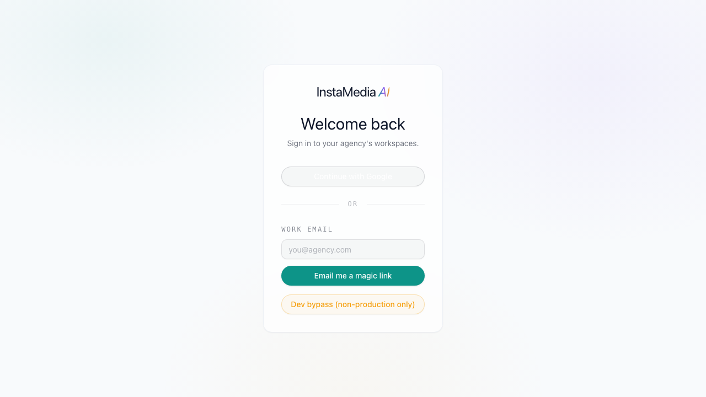

**First time in**, you'll land on a simple choice: claim a new organization for your agency, or join one with an invite code a teammate shares with you.

Once your workspace exists, this confirmation screen hands you a short code — teammates enter it at `/join` rather than waiting on an email invite:

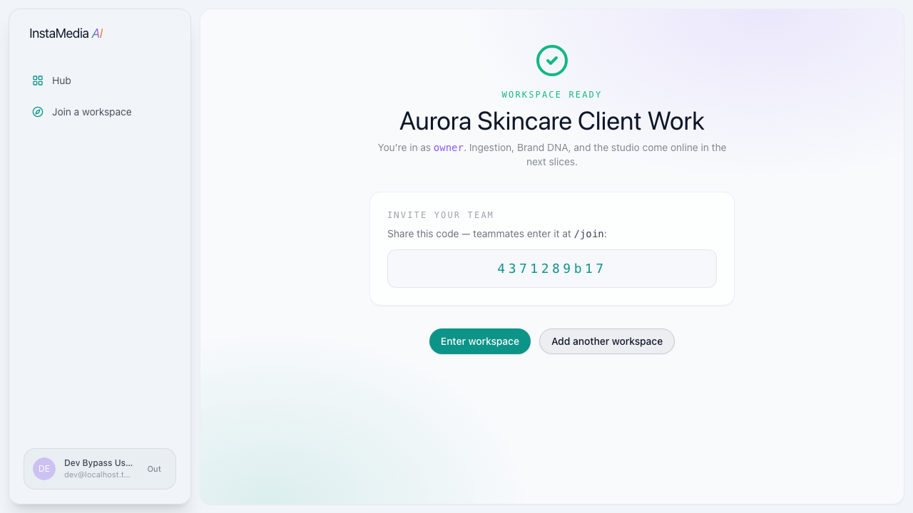

> **Note:** if your organization already has multiple workspaces (one agency can run several — one per department, or however you split it), you can create additional ones from the same "Add another workspace" flow at any time.

---

## 2. Onboarding a client

A client's **Brand DNA** — mission, voice, visual identity, what to avoid — is declared up front through a five-step intake wizard. This is what every AI-generated idea and draft is grounded in from day one.

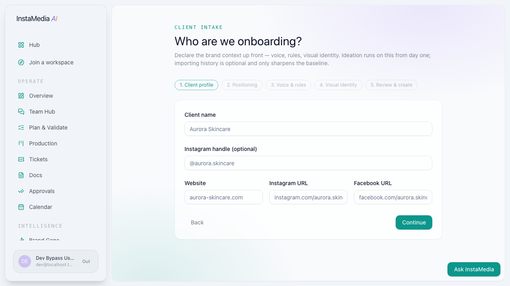

The five steps:

1. **Client profile** — name, handle, links.
2. **Positioning** — what kind of account this is (personal brand, product promotion, aesthetic/lifestyle, minimalistic, educational authority, or community/UGC), the mission in one or two sentences, and the visual theme.
3. **Voice & rules** — tone words, content pillars, and anything the brand should never say.
4. **Visual identity** — brand colors, typography, logo.
5. **Review & create.**

The result is a Brand DNA vault you can revisit and edit any time:

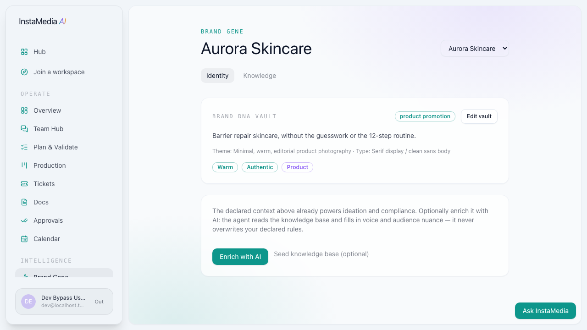

> **What's actually required vs. optional:** only mission, tone, and pillars gate ideation. Colors, logo, and importing a client's past post history (via CSV or connecting their Meta account) are all optional enrichment — a client can go from zero to their first idea in under two minutes. Importing history never overwrites what you've declared by hand; it only sharpens the baseline behind the scenes.

---

## 3. From idea to scheduled post

### Ideation

Give the Ideation page a client and a topic. It returns real, on-format suggestions grounded in that client's declared Brand DNA — not generic content ideas.

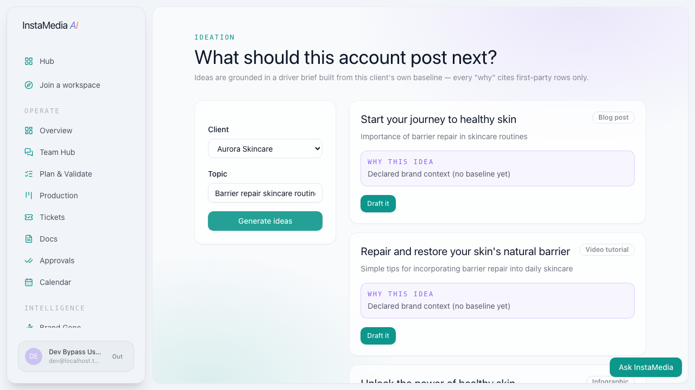

Each idea comes with a format (blog post, video tutorial, infographic, interview, podcast episode, product showcase) and an honest "why."

> **The rule that never bends:** until a client has enough of their own scored, published posts, every "why this idea" card says exactly that — *declared brand context, no baseline yet* — instead of inventing a performance number that doesn't exist yet. This isn't a caveat buried in a settings page; it's the literal text shown on the idea card, every time, for every client below that threshold.

### Drafting

Click **Draft it** on any idea and the AI writes a complete, structured draft — caption, script (broken into real sections for video/multi-part formats), hashtags, and a call to action:

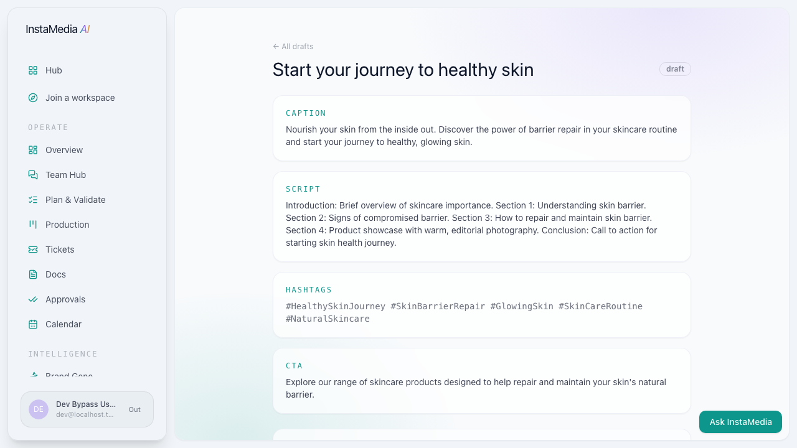

### Production

Every accepted idea lands automatically on the Production board at **Brief**. From there it's a simple pipeline:

**Brief → In progress → Internal review → Revision → Done**

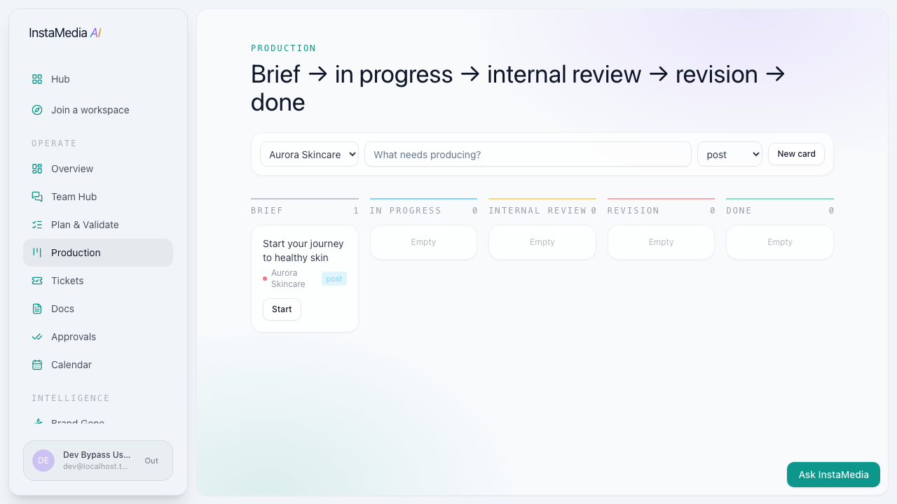

You can also add a card directly to the board without going through Ideation first — useful for anything that didn't start as an AI-suggested idea.

---

## 4. Tickets — tracking work that isn't content

Not everything an agency does is a post. Chasing a testimonial, calling a printer, following up on a signed asset — Tickets is where that operational work lives.

A ticket has:
- An **assignee** and an optional **due date**
- A **priority** (high / medium / low)
- Optionally, a **client** it's about, and a **link** back to a specific piece of content, idea, or campaign
- A status: **Open → In progress → Blocked → Done**

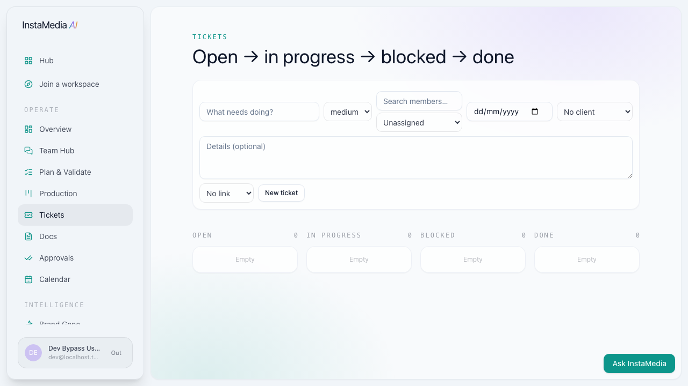

Once a workspace has more than a handful of people or clients, the assignee and link pickers become searchable — type to filter instead of scrolling a long dropdown.

Open any ticket to see its full detail page:

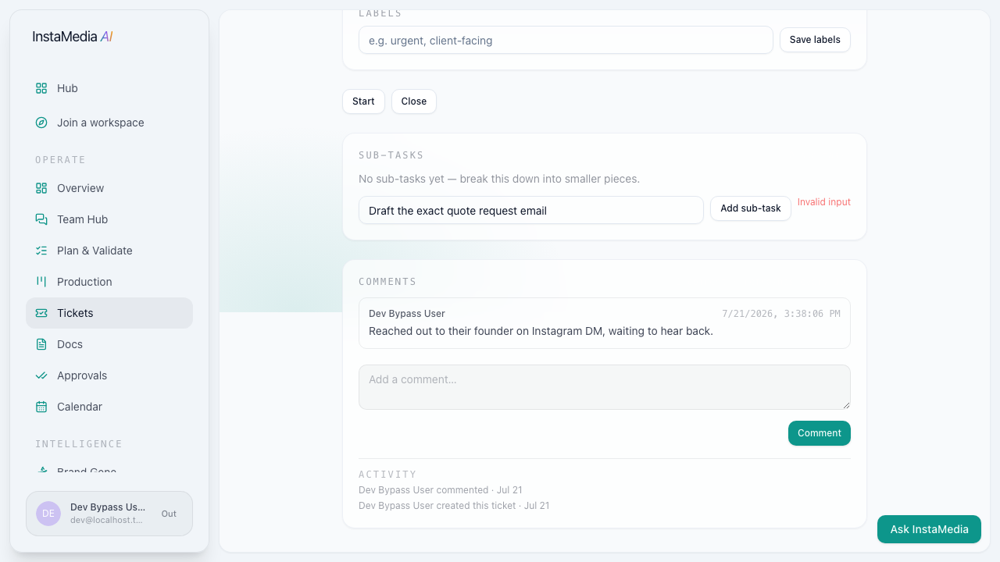

- **Sub-tasks** — break a ticket into smaller pieces without creating a whole new ticket.
- **Comments** — a running thread, each one timestamped and attributed.
- **Activity log** — every status change, assignment, and comment is recorded automatically. Nobody has to remember to log what happened.

> **Who can do what:** any team member can create tickets, comment, and move most statuses forward. Closing a ticket or reassigning it away from its current owner is limited to the ticket's owner/assignee or an admin — and deleting a ticket outright is owner-only. This is enforced on the server, not just hidden in the UI.

---

## 5. Automations — deterministic rules, no AI in the loop

Automations are plain, predictable rules — not another AI feature. An hourly check compares a **trigger** (an idea sitting stale for N days, an approval waiting too long, a high-priority ticket unassigned for N hours) against a **cadence**, and if it's due, runs one **action**: open a ticket, post a message to Team Hub, set a reminder, or email the team.

Three starter templates mean nobody has to build the first rule from a blank form:

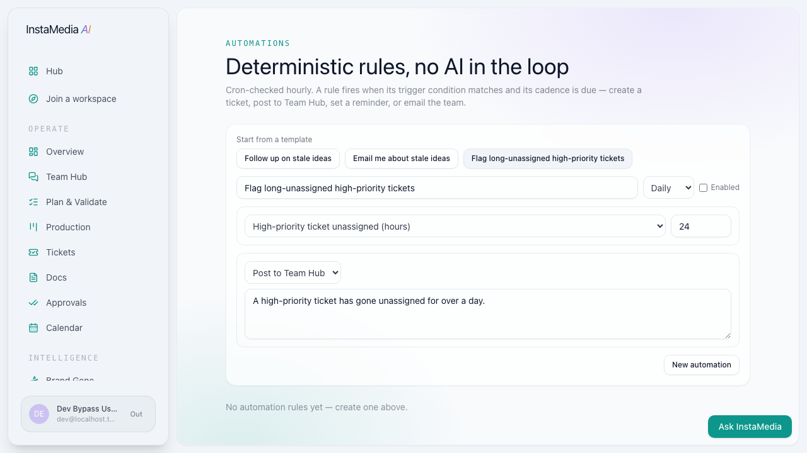

| Template | Trigger | Action |
|---|---|---|
| Follow up on stale ideas | Idea sits unassigned 3+ days | Create a ticket |
| Email me about stale ideas | Idea sits unassigned 3+ days | Email the team |
| Flag long-unassigned high-priority tickets | High-priority ticket unassigned 24+ hours | Post to Team Hub |

Every template is fully editable before you save — pick one as a starting point, then adjust the name, cadence, threshold, or message to fit.

> **A safety rail you'll notice if you go off-template:** picking "high-priority ticket unassigned" as a trigger quietly removes "create a ticket" from the action list. A ticket about an unassigned ticket doesn't help anyone, so that combination simply isn't offered.

---

## 6. Docs & SOPs

Docs are plain Markdown, shared across the whole workspace — for anything that shouldn't live only in one person's head. Mark a doc as an **SOP** (standard operating procedure) and it gets a small badge; everything else about it — the editor, the markdown rendering — is identical to a regular doc.

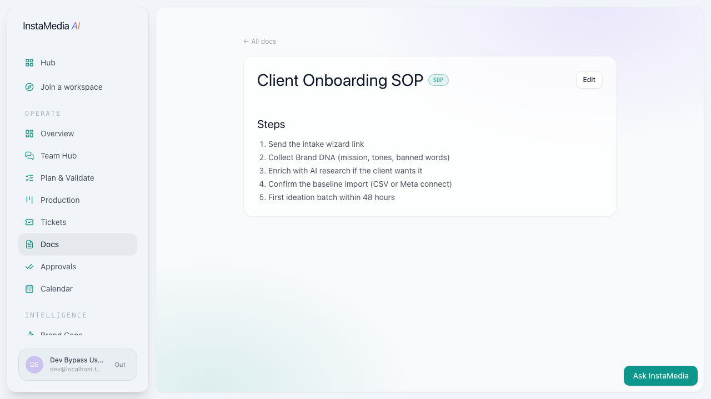

Use regular docs for notes, references, and anything informal. Use the SOP flag specifically for the repeatable processes you want new team members to be able to find and follow.

---

## 7. Team Hub

Team Hub is the workspace's shared channel — chat, sign-offs, shared tasks, and reminders in one place, with live presence so you can see who else is around.

- **Chat** — a running conversation, visible to the whole workspace.
- **Approval queue** — pending sign-offs waiting on a decision.
- **Tasks & priorities** — a quick shared checklist, separate from the full Tickets system; good for small one-off items that don't need an assignee, due date, or comment thread.
- **Shared reminders** — a date-and-time note visible to everyone.

---

## 8. Seeing what's working — Overview, Reports, Drift

### Overview

The workspace's morning screen — pipeline health at a glance: slots scheduled this month, open approvals, overdue slots, and ideas ready for review. Below that, a read-only **Marketing OS** glance pulls together AI spend against the daily cap, compliance drift status, open ticket count, and recent automation failures — each one links through to the real page where you'd actually act on it.

### Reports

First-party results only — every published post you record feeds back into the baseline. The page opens with a workspace-wide engagement trend and totals, then breaks down performance client by client: top and underperforming posts, format breakdown, and next month's scheduled count.

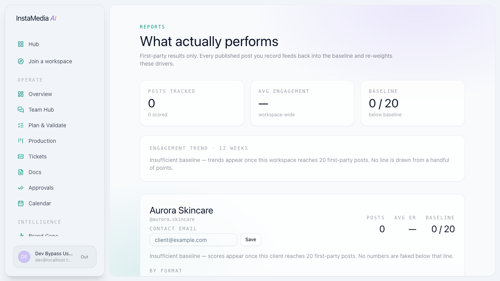

> **The same honesty rule as Ideation applies here:** a client below the baseline sample size shows "insufficient baseline," never a real-looking number built from three lucky posts.

### Drift

Brand Drift tracks how often a client's recent drafts needed a compliance rewrite — the closest signal this product has to brand-voice drift over time. Same rule: it shows nothing until there's enough data to mean something.

---

## 9. One client, one screen

Every client has a detail page that answers "what's going on with this client" without checking four different screens — their open tickets, their content currently in production, and their campaigns, together:

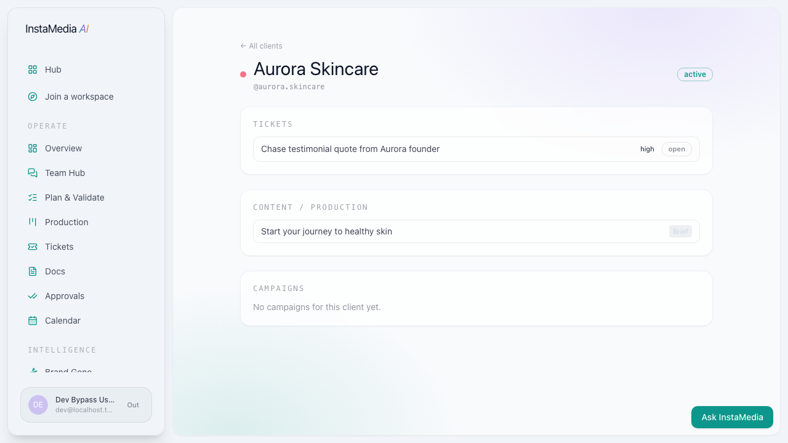

This is genuinely one of the most useful screens in the product if you're managing several clients at once — it's the fastest way to catch up on one account before a call.

---

## 10. Ask InstaMedia

A small assistant, always available in the bottom-right corner of every page. It answers questions grounded in this workspace's *own* real data — clients, upcoming scheduled posts, open tasks, pending approvals, and fresh ideas — never public or pattern-layer data.

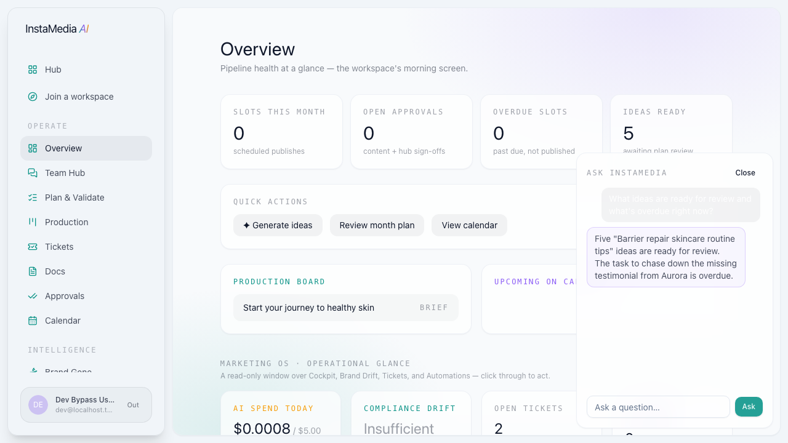

Click it, type a question, and it answers based on what's actually in your workspace right now. Example, asked live during this walkthrough:

> **Q:** *"What ideas are ready for review and what's overdue right now?"*
> **A:** *"Five 'Barrier repair skincare routine tips' ideas are ready for review. The task to chase down the missing testimonial from Aurora is overdue."*

Both facts in that answer were real and checked out against the workspace.

> **One thing worth knowing:** Ask InstaMedia summarizes in plain language — it isn't querying a spreadsheet cell by cell, and it can editorialize slightly (calling something "overdue" as a natural way of flagging urgency, even for a quick task that doesn't formally track due dates). Treat it as a fast, well-informed second opinion — for anything you're about to act on, glance at the real page it's referencing.

It does **not** take actions on your behalf — no creating, editing, or deleting anything. It only answers.

---

## 11. Quick reference — everything else in the sidebar

The sections above were walked through live, screen by screen. A few more live in the sidebar that this guide doesn't cover in the same depth yet — noted here so nothing's a mystery, and flagged honestly as reference-only until they get the same walkthrough treatment:

| Section | What it's for |
|---|---|
| **Approvals** | Content and campaign sign-offs waiting on a decision. |
| **Calendar** | The scheduled-post calendar view across all clients. |
| **Brand Gene** | The Brand DNA vault for each client (see [Section 2](#2-onboarding-a-client)) — also reachable directly from here. |
| **Creative Studio** | Where an individual draft is written, reviewed, and refined after Ideation hands it off. |
| **Knowledge Base** | What the account has learned — ingested post history, connected accounts, and pattern-layer research, kept clearly separate from first-party performance data. |
| **Ads Management** | Campaign tracking — targeting, creative, and status, linked back to the content behind each campaign. |
| **Cockpit** | AI spend and usage tracking against the daily cap. |
| **Connected Accounts** | Meta/Instagram account connections that keep the first-party baseline fresh automatically. |
| **Harness Rules** | Configuration for pattern-layer research scans (public inspiration — kept separate from your own baseline, per the two-layer rule mentioned throughout this guide). |

---

## 12. Notes from building this guide

This guide was written after actually clicking through the product in a real browser session, not from reading the code alone. That surfaced two real bugs along the way — both are already fixed:

- **Creating a ticket used to fail** if you left any picker at its default (unassigned, no client, no link) — which was, ironically, the most common way anyone would fill out the form.
- **Two labels on the Knowledge Base page were invisible** — correct text, wrong color, sitting white-on-white.

Both are fixed as of this writing. If something in this guide doesn't match what you see on screen, the product likely changed after this guide was written, not the other way around — flag it so the guide can catch up.
